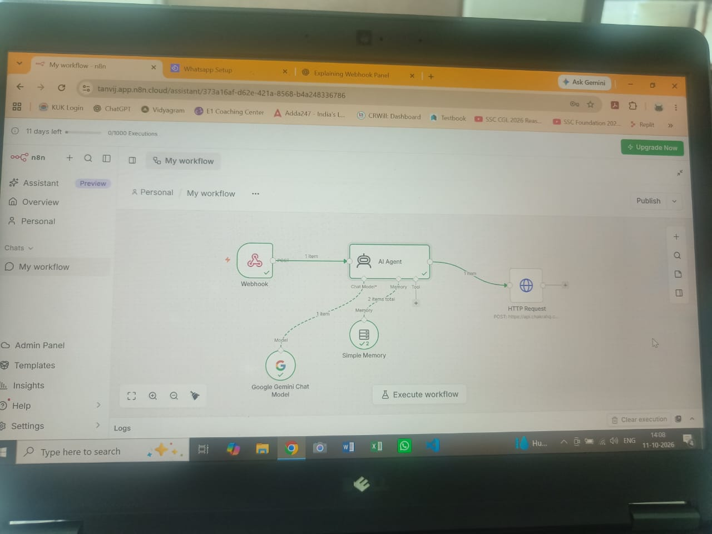
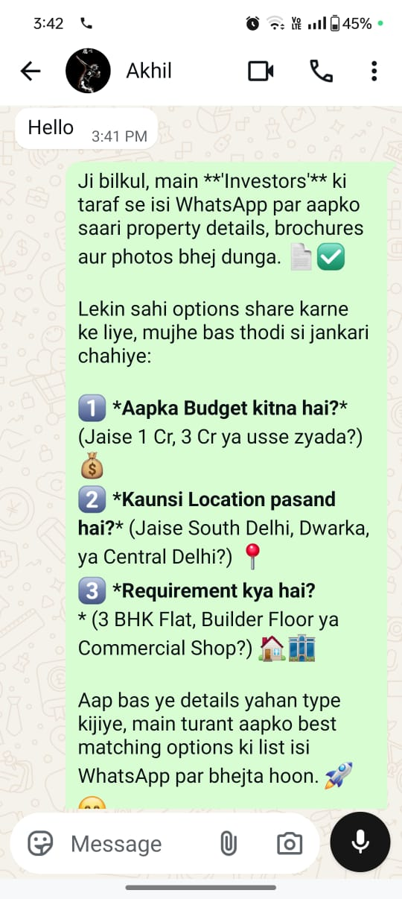

# AI-Powered WhatsApp Real Estate Automation

An AI-driven customer interaction and lead management prototype built using **n8n, Chakra HQ, and an LLM-based AI Agent**.

## Overview

This project explores the automation of real estate customer inquiries through WhatsApp. It connects WhatsApp event handling with an AI Agent to process incoming messages and generate conversational responses, with the goal of streamlining initial customer interactions and lead management.

## Objectives

- Automate responses to incoming real estate inquiries.
- Explore AI-powered customer conversations through WhatsApp.
- Capture customer information and support lead creation.
- Reduce repetitive manual communication.
- Design a workflow that can be extended with property recommendations and lead qualification.

## Tools & Technologies

- **n8n:** Visual workflow automation and API integration.
- **Chakra HQ:** WhatsApp integration and lead/process management.
- **AI Agent & LLM:** Natural-language response generation.
- **HTTP Request / REST API:** Communication with external services.
- **WhatsApp Cloud API:** WhatsApp messaging integration, where configured.

## Workflow Architecture

1. A customer sends a message through WhatsApp.
2. Chakra HQ and the webhook integration handle incoming events.
3. n8n processes the incoming message.
4. The AI Agent generates a response based on the configured instructions.
5. An HTTP Request sends the response through the WhatsApp messaging API.
6. Customer details can be used for lead management, depending on the configured workflow.

## Potential Applications

- Initial real estate inquiry handling
- Lead capture and qualification
- Customer requirement collection
- Property inquiry assistance
- Follow-up workflow automation

## Current Status

Prototype / learning project. The workflow is being configured and tested, including webhook handling, AI response generation, memory, and outgoing WhatsApp API requests.

## Future Enhancements

- Reliable conversation memory for individual customers
- Property search based on budget and location
- Lead qualification and CRM integration
- Automated follow-ups
- Error handling, logging, and production deployment safeguards

## Note

This repository documents the project architecture and implementation approach. It does not contain the underlying n8n workflow export or application source code.

Sensitive credentials, access tokens, customer data, and private configuration details are intentionally excluded.# ai-whatsapp-real-estate-automation
AI-powered WhatsApp automation for real estate lead management using n8n and Chakra HQ.
## Project Screenshots

### n8n Workflow

### WhatsApp Demo

